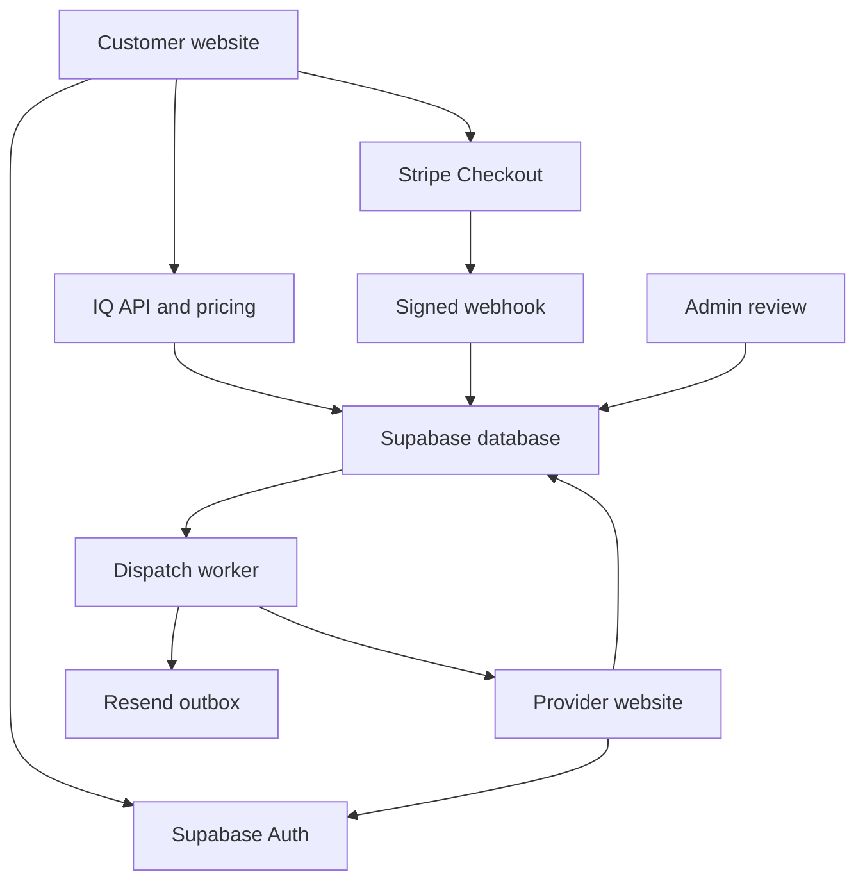

# Architecture and workflow map

Customer: visit → describe request → deterministic approved quote → signed-in durable quote/booking → Stripe checkout → verified paid webhook → paid pending job → worker evaluates businesses → eligible offers → atomic first acceptance → assigned provider → travel → arrival → before photo → work → during/after evidence → completion. Quote conversation persistence and customer tracking are separate authenticated APIs against the same database.

Provider: register → email verification → resume application → business/services → private documents → versioned agreements → submit → reviewer decision → approved business/membership → online heartbeat → eligible offers → accept/work. Team membership scopes operations; it must not bypass the owner's approval.

Own-client work: business owner/billing role → private client/job → estimate snapshot and private decision link → invoice record → expense/time entries. It does not enter marketplace dispatch, collect payments, or establish reconciled cash profit.

**Missing links:** contractual checkout acceptance record; atomic payment settlement; complete confirmation/admin email events; explicit approved coverage waves and no-supply escalation; cancellation/reassignment/reschedule/dispute paths; actual payout eligibility/transfer/reconciliation; operational closure.

The desired state machine extends beyond today's implemented state fields. Do not label `completed` as paid out. Desired progression: quote started/ready → payment pending/confirmed → provider search/assigned → en route/arrived/working/completed → payout eligible/paid out/closed. Cancellation, reschedule, refund, and dispute require explicit guarded branches and financial records rather than direct arbitrary status edits.
